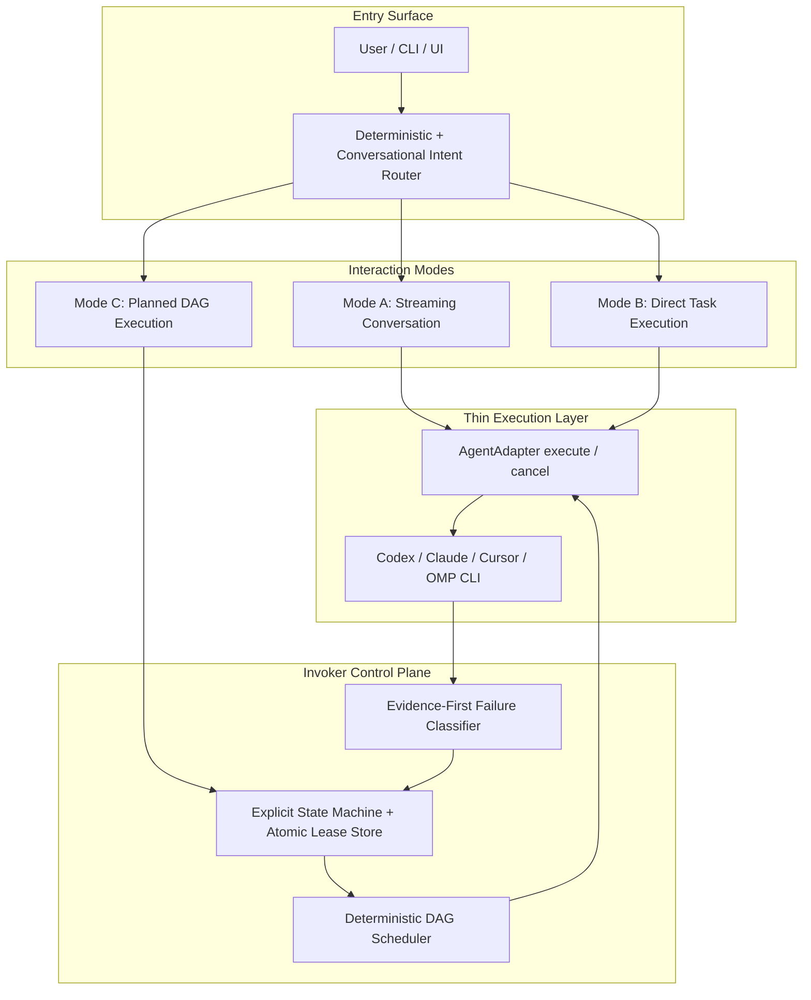
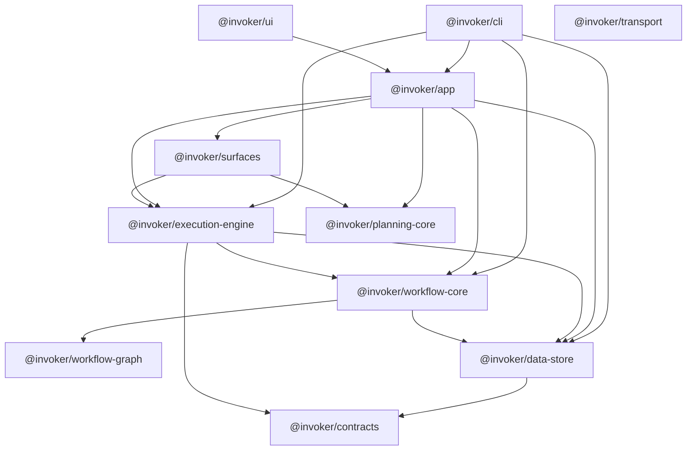

# Architectural Simplification — Phase 0 Inventory

**Date:** 2026-10-23  
**Review claim:** Trace every CLI-to-execution call path, model invocation, prompt expansion, background worker, and persistence table to establish an explicit retention/removal inventory before modifying runtime code.  
**Review lane:** `docs`  
**Safety invariant:** Read-only architecture trace and classification; zero runtime or persistence changes.

This document is the Phase 0 deliverable for the [architectural simplification rebuild plan](https://github.com/Neko-Catpital-Labs/Invoker). It records **current** behavior as observed in the repository at audit time. Later phases change code; this file is the baseline manifest.

---

## Target control-plane shape (north star)



---

## 1. Architecture trace (entry → execution)

### 1.1 Package layering (runtime)



Legacy aliases: `@invoker/persistence` re-exports `@invoker/data-store` (`packages/persistence/src/index.ts`). `@invoker/core` and `@invoker/graph` remain in the tree for older imports; active orchestration lives in `@invoker/workflow-core` and `@invoker/workflow-graph`.

### 1.2 CLI → workflow execution

| Step | Location | What happens |
| --- | --- | --- |
| Dispatch | `packages/cli/src/index.ts` → `packages/cli/src/cli-runtime.ts` `main()` | Top-level commands: `install`, `setup`, `doctor`, `mcp`, `owner serve`, `query`, `wait`, `retry*`, `run`, workers, etc. |
| Plan run (standalone) | `cli-runtime.ts` (~1207–1266) | Creates `SQLiteAdapter`, `Orchestrator`, `TaskRunner`, `WorktreeExecutor`; `loadPlan` + `startExecution` + `executeTasks`. |
| Plan run (live owner) | `cli-runtime.ts` `run` with live delegation | Submits plan to running owner via message bus (same orchestration path inside owner). |
| Headless owner | `cli-runtime.ts` `runHeadlessOwnerServe` | Spawns Electron/main owner process (`owner serve`). |

**Primary task path after `loadPlan`:**

1. `Orchestrator` (`packages/workflow-core/src/orchestrator.ts`) schedules ready tasks via `scheduler-domain` / `transitions`.
2. `TaskRunner.executeTask` → `executeTaskInner` (`packages/execution-engine/src/task-runner.ts`) claims launch dispatch, selects executor from `ExecutorRegistry`.
3. `WorktreeExecutor` / `DockerExecutor` / `SshExecutor` / `ScratchExecutor` extend `BaseExecutor` (`base-executor.ts`): build prompt, spawn agent CLI via `ExecutionAgent` + optional `SessionDriver`.
4. `Orchestrator.handleWorkerResponse` persists terminal state; workers and autofix react via message bus + SQLite.

### 1.3 Desktop owner (Electron)

| Step | Location | What happens |
| --- | --- | --- |
| Boot | `packages/app/src/main.ts` | Wires persistence, `Orchestrator`, `TaskRunner`, IPC handlers, `registerBuiltinWorkers`. |
| Plan submit | `loadPlanSubmissionBundle` (`plan-submission-loader.ts`) | UI/headless plan text → validated bundle → `orchestrator.loadPlan`. |
| Planning chat | `packages/app/src/in-app-planner.ts` | Session CRUD, `sendPlanningChatMessage`, worktree binding, delegates to `PlanConversation`. |

### 1.4 Slack / surfaces

| Step | Location | What happens |
| --- | --- | --- |
| Thread agent mode | `packages/surfaces/src/slack/plan-conversation.ts` | `sendMessage` → `sendMessageLocked` → `spawnPlanner` (harness CLI). |
| One-shot Q&A | `packages/surfaces/src/slack/slack-surface.ts` `runOneShotPlanner` (~2187+) | Ephemeral planner subprocess for Slack prompts without full plan conversation state. |
| Workflow submit | Slack surface + app bridge | Confirmed plans → same `loadPlan` / owner path as UI. |

### 1.5 Planning-only path (no DAG until submit)

```
UI or Slack message
  → in-app-planner.createSession / sendPlanningChatMessage
  → PlanConversation.sendMessage
  → spawnPlanner (HarnessSessionDriver → claude/codex/cursor/omp CLI)
  → optional YAML extraction / confirmation
  → loadPlanSubmissionBundle (Mode C only)
  → Orchestrator + TaskRunner (Section 1.2)
```

**Current coupling:** `createSession` in `in-app-planner.ts` (~950–961) calls `provisionPlanningWorktree` when `repoPool` and `repoBinding` are present—before the first user message—so conversational opens can still allocate a git worktree.

---

## 2. Model-call inventory

Classification key:

- **Primary agent** — user-facing coding/planning work; should remain on the critical path for that mode.
- **Invoker overhead** — extra LLM/CLI invocations Invoker adds beyond the user's task (target: remove or cap in Phases 1–2, 6–7).

| ID | Site | Trigger | Mechanism | Class | Phase |
| --- | --- | --- | --- | --- | --- |
| M1 | `execution-engine` task executors via `BaseExecutor.buildFullPrompt` | Every `ai_task` | Prepends `buildWorkerOrientationPack` (~109–129, injected ~1628–1630) before agent CLI | Invoker overhead | 1 |
| M2 | `task-runner.ts` `authorPrBodyWithSkill` (~1539+) | Merge/publish completion | `spawnAgentPrAuthorViaRegistry` in `pr-authoring.ts` (~1092+) with `buildMakePrPrompt` (~994+) | Invoker overhead | 1 |
| M3 | `conflict-resolver.ts` `resolveConflictImpl` (~152+), `fixWithAgentImpl` (~531+), `spawnAgentFixViaRegistry` (~808+) | Merge conflict / operator fix | Secondary agent session in workspace | Primary repair (bounded) | 4 |
| M4 | `review-gate-ci-repair.ts` `queueReviewGateCiRepair` (~588+) | Review-gate CI failure | Spawns repair workflow (may include agent tasks) | Invoker overhead / recovery | 4, 6 |
| M5 | `plan-conversation.ts` `spawnPlanner` (~1231+) | Each planning/agent turn | Harness CLI via `HarnessSessionDriver` | Primary (mode-dependent) | 2 |
| M6 | `plan-conversation.ts` `buildPlanSystemPrompt` (~499+), `buildCursorPrompt` (~1158+), `buildPlanningHandoffInstructions` (`planning-core/planning-handoff-prompt.ts` ~11–38) | Plan-mode turns | Large static system prompt + handoff block | Invoker overhead (plan mode) | 2 |
| M7 | `slack-surface.ts` `runOneShotPlanner` (~2187+) | Slack Q&A / local-change prompts | One-shot CLI | Primary or overhead (context-dependent) | 2 |
| M8 | `in-app-planner.ts` `createSession` / `sendPlanningChatMessage` (~912+, ~1289+) | UI planning chat | Same as M5–M6 via `PlanConversation` | Primary + overhead | 2 |
| M9 | `workers/agent-login-watch-worker.ts` `AGENT_LOGIN_PROBE_PROMPT` (~17), probe runner (~163+) | Periodic worker tick | CLI prompt `"Reply with just the word ok"` | Invoker overhead | 6 |
| M10 | `slack-bug-scan/src/real-classifier.ts` `createSlackBugScanClassifier` (~13–46) | `slack-bug-scan` worker | Direct Anthropic `messages.parse` API | Invoker overhead | 6 |
| M11 | `auto-fix-recovery.ts` worker (`AUTO_FIX_WORKER_KIND` = `autofix`) | Failed task events | Publishes fix/retry/recreate intents → agent fix path (M3) | Recovery overhead | 4 |
| M12 | `TaskRunner.executeTaskInner` (~732+) | DAG task execution | Agent CLI via registered `ExecutionAgent` / session drivers | Primary agent | 1 (wrap as `AgentAdapter`) |

**Session driver / agent abstraction sites (consolidation targets):**

- `packages/execution-engine/src/agent.ts` — `ExecutionAgent`, `PlanningAgent`
- `packages/execution-engine/src/session-driver.ts` — `SessionDriver`
- `packages/execution-engine/src/harness-session-driver.ts` — planning harness selection
- Per-provider: `claude-session-driver.ts`, `codex-session-driver.ts`, `omp-session-driver.ts`, `agents/*-execution-agent.ts`, `agents/*-planning-agent.ts`

---

## 3. Prompt expansion inventory (non-model bytes)

| Site | What gets injected | When |
| --- | --- | --- |
| `buildWorkerOrientationPack` | Package guess, scope heuristics, HEAD SHA reconciliation prose | Every DAG `ai_task` (M1) |
| `buildFullPrompt` upstream block | Completed dependency summaries | Tasks with upstream dependencies |
| `buildPlanSystemPrompt` + stacked workflow templates | YAML schema, repo policy, merge-mode instructions | Plan conversation plan mode |
| `SLACK_LOCAL_REPRO_POLICY`, `TASK_FRESHNESS_PROMPT` | Slack execution boundary copy | Slack plan/agent modes |
| `buildPlanningHandoffInstructions` | Review/submit/approval choreography | Plan mode turns |
| `buildMakePrPrompt` | Full make-pr skill invocation instructions | AI PR authoring (M2) |
| `materializeLocalAgentPrompt` | Writes large prompts to temp files for CLI argv limits | Planner, PR author, fixes |

Phase 1–2 goal: task execution receives task objective, constraints, structured predecessor artifacts, and verification contract only; conversational mode uses a minimal system prompt without YAML/handoff blocks.

---

## 4. Background workers

### 4.1 Registered at owner startup

Source: `packages/execution-engine/src/builtin-workers.ts` `registerBuiltinWorkers` (order preserved).

| Worker kind | Module | Retention (Phase 0 classification) |
| --- | --- | --- |
| `autofix` | `auto-fix-recovery.ts` | **Retain** — simplify in Phase 4 (bounded, evidence-first) |
| `requeue` | `workers/requeue-worker.ts` | **Retain** — fold into startup reconciliation (Phase 3) |
| `workflow-resume` | `workers/workflow-resume-worker.ts` | **Retain** |
| `pr-status` | `workers/pr-status-worker.ts` | **Retain** (publication observability) |
| `infra-repair` | `workers/infra-repair-worker.ts` | **Retain** (infra class) |
| `disk-headroom` | `workers/disk-headroom-worker.ts` | **Defer** — lifecycle-bound cleanup preferred (Phase 5) |
| `claude-oauth-refresh` | `workers/claude-oauth-refresh-worker.ts` | **Remove** (Phase 6) |
| `reaper` | `workers/reaper-worker.ts` | **Retain** |
| `db-reaper` | `workers/db-reaper-worker.ts` | **Retain** |
| `autoapprove` | `workers/auto-approve-worker.ts` | **Remove** (Phase 6) |
| `pr-admin-bypass-land` | `workers/pr-maintenance-workers.ts` | **Remove** (Phase 6) |
| `pr-orphan-repair` | `workers/pr-maintenance-workers.ts` | **Remove** (Phase 6) |
| `pr-duplicate-close` | `workers/pr-maintenance-workers.ts` | **Remove** (Phase 6) |
| `pr-jailbreak-land` | `workers/pr-maintenance-workers.ts` | **Remove** (Phase 6) |
| `pr-auto-label` | `workers/pr-maintenance-workers.ts` | **Remove** (Phase 6) |
| `e2e-autofix` | `workers/e2e-autofix-worker.ts` | **Remove** (Phase 6) |
| `worker-session-mine` | `workers/worker-session-mine-worker.ts` | **Remove** (Phase 6) |
| `session-token-push` | `workers/session-token-push-worker.ts` | **Remove** (Phase 6; telemetry unification Phase 7) |
| `slack-bug-scan` | `workers/slack-bug-scan-worker.ts` + `@invoker/slack-bug-scan` | **Remove** (Phase 6) |
| `idle-task-cleanup` | `workers/idle-task-cleanup-worker.ts` | **Retain** |
| `cross-repo-research` | `workers/cross-repo-research-worker.ts` | **Remove** (Phase 6) |
| `catstack-deploy` | `workers/catstack-deploy-worker.ts` | **Remove** (Phase 6) |
| `self-deploy` | `workers/self-deploy-worker.ts` | **Remove** (Phase 6) |
| `admin-bypass-e2e-babysit` | `workers/admin-bypass-e2e-babysit-worker.ts` | **Remove** (Phase 6) |
| `mergify-queue-research` | `workers/mergify-queue-research-worker.ts` | **Remove** (Phase 6) |
| `spend-circuit-breaker` | `workers/spend-circuit-breaker-worker.ts` | **Retain** (spend safety) |
| `workflow-cleanup` | `workers/workflow-cleanup-worker.ts` | **Retain** |
| `agent-login-watch` | `workers/agent-login-watch-worker.ts` | **Remove** (Phase 6) |

CLI worker entrypoints (`invoker-cli worker`, `run-worker`) use `registerAutoFixWorker` + external worker config—not the full owner `registerBuiltinWorkers` list— for isolated worker processes.

### 4.2 Present in tree but not in `registerBuiltinWorkers`

| Worker kind | Module | Notes |
| --- | --- | --- |
| `thrash-detector` | `workers/thrash-detector-worker.ts` | Implemented + tested; **not** registered in `builtin-workers.ts`. Treat as **remove or wire explicitly** in Phase 6 cleanup. |

---

## 5. SQLite persistence manifest

Source: `packages/data-store/src/sqlite-schema.ts`.

### 5.1 Core orchestration (retain)

| Table | Role |
| --- | --- |
| `workflows` | Workflow metadata and lifecycle |
| `tasks` | Task graph nodes and status |
| `attempts` | Attempt records, lease fencing |
| `task_launch_dispatch` | Atomic launch claims |
| `execution_resource_leases` | Executor/worktree capacity |
| `workflow_mutation_leases` | Serialized workflow mutations |
| `workflow_mutation_intents` | Mutation queue |
| `task_output` | Streamed task logs |
| `events` / `event_type_counters` | Event stream |
| `queue_history` | Scheduler audit |

### 5.2 Recovery and verification (retain)

| Table | Role |
| --- | --- |
| `task_crash_preservation` | Crash diagnostics |
| `task_session_recovery` | Agent session recovery metadata |
| `repair_filings` | Infra/repair worker filings |
| `worker_actions` | Worker dedup / caps |
| `worker_desired_states` | Worker enablement |

### 5.3 Planning and surfaces (retain; simplify usage in Phase 2)

| Table | Role |
| --- | --- |
| `conversations` / `conversation_messages` | Generic conversation store |
| `planning_drafts` | In-progress plan drafts |
| `in_app_planning_sessions` / `in_app_planning_messages` | UI planning chat |
| `slack_launch_contexts` / `slack_plan_drafts` / `slack_pending_confirmations` | Slack plan state |
| `workflow_channels` | Surface routing |

### 5.4 Operational / sync (retain unless feature removed)

| Table | Role |
| --- | --- |
| `activity_log` | Operator activity |
| `output_spool` | Output spooling |
| `terminal_sessions` | Embedded terminal persistence |
| `sync_journal` / `sync_cursors` | Sync helpers |

**Phase 3 focus:** enforce single transition table against `tasks` + `attempts` + `task_launch_dispatch` with lease fencing; other tables unchanged in Phase 0.

---

## 6. Component retention / removal manifest

### 6.1 Essential — retain and simplify

| Component | Path | Notes |
| --- | --- | --- |
| CLI lifecycle | `packages/cli/src/index.ts`, `cli-runtime.ts` | Keep `run`, `query`, `wait`, `retry`, `cancel`, `doctor`, `setup`; trim worker-specific flags in Phase 6 |
| DAG validation | `packages/workflow-graph/src/dag.ts`, `types.ts` | Topological order, level computation |
| Orchestrator | `packages/workflow-core/src/orchestrator.ts`, `orchestrator/transitions.ts`, `orchestrator/scheduler-domain.ts` | Consolidate explicit state machine (Phase 3) |
| SQLite store | `packages/data-store/src/sqlite-schema.ts`, `sqlite-adapter.ts` | Single writer; lease APIs |
| Executors | `worktree-executor.ts`, session drivers | Consolidate behind `AgentAdapter` (Phase 1) |
| Failure taxonomy | `packages/workflow-graph/src/failure-classifier.ts`, `contracts/verification-contract.ts` | Align to 7-class deterministic taxonomy (Phase 4) |
| Core lifecycle workers | `requeue-worker`, `workflow-resume-worker`, `reaper-worker` | Bounded reconciliation (Phase 3) |

### 6.2 Duplicated — consolidate

| A | B | Action |
| --- | --- | --- |
| `@invoker/persistence` | `@invoker/data-store` | Alias only; inline consumers in Phase 6 |
| `ExecutionAgent` + `PlanningAgent` | `SessionDriver` + `HarnessSessionDriver` | Single `AgentAdapter` (Phase 1) |
| `execution-engine/auto-fix-recovery.ts` | `app/src/workers/auto-fix-recovery.ts` | App path is re-export shim only |
| `scripts/session-token-rollup.py` | `app/cost-rollup.ts`, `execution-engine/spend-attribution.ts` | Unify TypeScript telemetry (Phase 7) |

### 6.3 Expensive / low core value — remove (Phase 1, 6)

- AI PR-body authoring (M2)
- `buildWorkerOrientationPack` (M1)
- Eager planning worktree on session create (Section 1.5)
- Always-on plan system prompts for conversational turns (M6)
- Non-core workers listed in Section 4.1 as **Remove**
- CLI: `auto-approve-authors`, deleted-worker toggles, optional `spend-gate` daemon surface (Phase 6)

### 6.4 Defer / opt-in

| Component | Path | Default |
| --- | --- | --- |
| `DockerExecutor` | `docker-executor.ts` | Opt-in pool target |
| `SshExecutor` | `ssh-executor.ts` | Opt-in remote target |
| Slack / Discord / watcher packages | `slack-manager`, `discord`, `watcher`, `npm-slack` | Decouple from core owner startup |
| `disk-headroom` worker | `disk-headroom-worker.ts` | Replace with lifecycle sweeps where possible |

---

## 7. CLI command surface (audit snapshot)

Top-level commands handled in `cli-runtime.ts` `main()`:

- Lifecycle: `install`, `uninstall`, `setup`, `doctor`
- Owner: `owner serve`
- Operations: `run`, `query`, `wait`, `retry`, `retry-task`, `retry-tasks`, `resume`, `delete`, `delete-all`, `set`
- Integrations: `mcp`, `agent-login`, `spend-gate`, `auto-approve-authors`
- Workers: `worker`, `run-worker`

Default workflow execution remains `invoker-cli run <plan.yaml>` (standalone or live delegation).

---

## 8. Phase map (this inventory → later work)

| Phase | Uses this document for |
| --- | --- |
| 1 | M1, M2, M12; `AgentAdapter`; executor prompt policy |
| 2 | M5–M8, M6–M7; mode routing; worktree eager provision |
| 3 | Core tables; worker fold (`requeue`, `reaper`) |
| 4 | M3, M4, M11; failure classifier; autofix bounds |
| 5 | Executors/worktree policy; `disk-headroom` deferral |
| 6 | Section 4.1 removals; CLI flag prune; package alias |
| 7 | Token rollup split (`agentUsage` vs `invokerOverhead`) |
| 8 | Benchmark arms proving overhead zero where claimed |

---

## 9. Verification (Phase 0)

Phase 0 produces **documentation only**. No verification command is required to land this slice; downstream phases cite the test commands in the master plan (`pnpm test`, package-scoped filters).

**Audit method:** static read of cited modules and schema; worker list cross-checked against `registerBuiltinWorkers` registration order in `builtin-workers.ts`.
